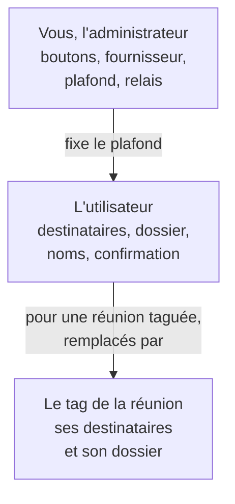

L'onglet **Administration → Actions** décide des **boutons** proposés après chaque réunion et chaque
résumé — **Envoyer par mail**, **Entreposer**, **Télécharger** —, du **fournisseur** des comptes que
les utilisateurs relient, et des **limites** de leurs envois.

## À quoi ça sert

À ouvrir la diffusion des comptes rendus à la mesure de votre politique : tout ouvert pour une équipe
commerciale, le téléchargement seul pour un service qui ne doit rien envoyer hors de l'organisation.

## Comment ça marche

**Vous êtes un plafond, pas un défaut.** Ce que vous fermez disparaît pour tous et ne se rouvre pas ;
ce que vous ouvrez, chaque utilisateur l'affine — ses destinataires, son dossier, ses formats de nom.

| Réglage | Qui décide |
|---|---|
| Les boutons proposés — six interrupteurs | **Vous** |
| Le fournisseur des comptes reliés | **Vous** |
| Le plafond de destinataires, le relais vers des tiers | **Vous** |
| Le dossier de dépôt | Le tag de la réunion, sinon l'utilisateur, sinon vous |
| Les destinataires | Le tag, sinon l'utilisateur. Son adresse est toujours en copie |
| L'objet du mail, le nom des fichiers | L'utilisateur, sinon vous |
| La confirmation avant dépôt | L'utilisateur |

**Six interrupteurs** : chaque action existe **après chaque réunion** — sur l'onglet **Transcription** —
et **après chaque résumé** — sur l'onglet **Résumé**. Par défaut, les six sont ouverts, et le fournisseur
est **Aucun** : le bouton **Entreposer** n'apparaît qu'une fois un fournisseur choisi.

**Ce que chaque bouton demande** en plus de son interrupteur :

| Bouton | Il faut aussi |
|---|---|
| **Envoyer par mail** | Le relais d'envoi du serveur, ou un compte relié par l'utilisateur |
| **Entreposer** | Un fournisseur choisi ici, et un compte relié par l'utilisateur |
| **Télécharger** | Rien |

**Les garde-fous**, qui ne se désactivent pas :

- les destinataires et le dossier ne viennent **jamais** de la demande d'envoi, seulement des réglages
  enregistrés : on ne peut pas faire partir un compte rendu vers une adresse improvisée ;
- l'adresse de l'utilisateur est **toujours en copie** ;
- le nombre de destinataires est plafonné — par vous, jusqu'à vingt ;
- chaque envoi laisse une trace : qui, à qui, quand, sans le contenu, gardée 90 jours.

**Les changements** arrivent chez les utilisateurs au prochain chargement de myBrief.

## Configurer

| Réglage | Où | Effet | Page |
|---|---|---|---|
| Interrupteurs **Après chaque réunion**, **Après chaque résumé** | Actions → Envoyer par mail, Entreposer, Télécharger | Les boutons proposés | [Choisir les boutons proposés](choisir-les-boutons-proposes.md) |
| **Fournisseur**, **Proposer les bibliothèques SharePoint**, **Dossier cible** | Actions → Compte relié, Entreposer | Google ou Microsoft, les bibliothèques SharePoint, et le dossier de dépôt par défaut | [Choisir le compte relié](choisir-le-compte-relie.md) |
| **Destinataires maximum**, **Autoriser le relais du serveur à écrire à des tiers**, **Objet du mail** | Actions → Envoyer par mail | Les limites et le format des envois | [Régler l'envoi par mail](regler-l-envoi-par-mail.md) |
| **Nom des fichiers par défaut** | Actions → Nom des fichiers par défaut | Le nom des documents envoyés et déposés | [Nommer les fichiers par défaut](nommer-les-fichiers-par-defaut.md) |
| **Tester l'envoi**, **Tester le dépôt** | Actions | Une exécution réelle avec les valeurs de l'organisation | [Tester la configuration](tester-la-configuration.md) |

## Exemples de configuration

**Une équipe commerciale sous Google Workspace.** Fournisseur **Google (Gmail + Drive)**, six
interrupteurs ouverts, 15 destinataires au plus, dossier cible *myBrief/Comptes-rendus*. Chacun relie son
compte ; les tags par client font le reste.

**Un service qui ne diffuse rien.** **Envoyer par mail** et **Entreposer** fermés, **Télécharger** ouvert
après chaque résumé seulement.

**Sous Microsoft 365, avec SharePoint.** Fournisseur **Microsoft (Outlook + OneDrive)** ; l'application
Microsoft Entra porte les permissions d'envoi, de fichiers et de sites SharePoint. Les utilisateurs
choisissent eux-mêmes une bibliothèque SharePoint par tag.

## Vérifier que tout fonctionne

1. **Ce que verront vos utilisateurs**, en tête de l'onglet : la barre de boutons telle qu'elle
   apparaîtra.
2. **Tester l'envoi** et **Tester le dépôt**, avec votre compte.
3. Avec un compte de test : relier un compte, envoyer un compte rendu, entreposer.

## Voir aussi

- [Les actions après réunion, côté utilisateur](../../fonctionnalites/actions/index.md)
- [La connexion](../connexion/index.md) — les applications Google et Microsoft dont dépendent les comptes reliés
