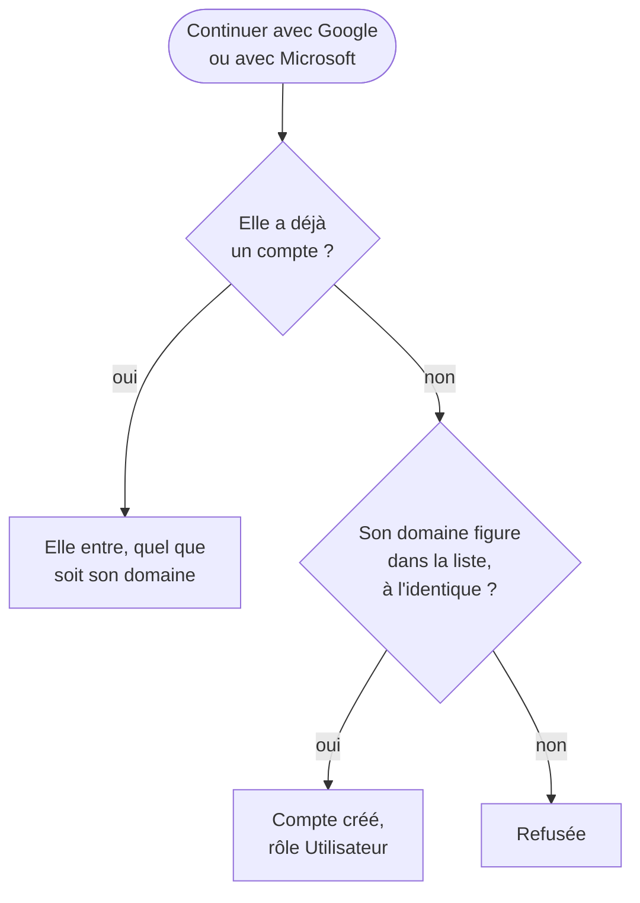

L'onglet **Administration → Authentification** décide de ce que propose la page de connexion : **Email
et mot de passe**, **Continuer avec Google**, **Continuer avec Microsoft**, et le **SSO historique**
s'il existe encore. Il porte aussi les identifiants Google et Microsoft, et la liste des **domaines
autorisés**.

## À quoi ça sert

À faire entrer vos équipes avec le compte qu'elles utilisent déjà, sans mot de passe de plus, et à
réserver l'accès à votre organisation.

## Comment ça marche

**La carte Page de connexion** montre chaque mode tel que vos utilisateurs le verront, **Affiché** ou
**Masqué**. Le mot de passe et le SSO historique s'affichent par leur interrupteur ; Google et Microsoft,
en les activant dans leur carte, identifiants complets. **Au moins un mode doit rester affiché**, sinon
plus personne ne peut se connecter — vous compris.

**Les identifiants servent à deux choses.** Ceux de Google et de Microsoft ouvrent la connexion, mais
permettent aussi aux utilisateurs de **relier leur compte** pour l'envoi des mails et le dépôt des
fichiers — même quand la connexion par ce fournisseur est masquée. Les droits exacts que cela demande,
et les réglages de vos consoles qui peuvent les bloquer, sont dans
[Autoriser myBrief dans Google Workspace](autoriser-mybrief-dans-google-workspace.md) et
[Autoriser myBrief dans Microsoft Entra ID](autoriser-mybrief-dans-microsoft-entra-id.md).

**Les domaines autorisés** décident qui obtient un compte à sa première connexion par Google ou par
Microsoft. Un compte qui existe déjà entre, quel que soit son domaine.

**Ce qui dépend du serveur**, et donc de MyAlfred : l'existence de la connexion par mot de passe, les
identifiants Microsoft Entra fournis au déploiement, le SSO historique, et l'envoi de mails — sans lui,
pas de lien **Mot de passe oublié ?**.

**Un seul bouton Enregistrer**, en bas de l'onglet.

## Configurer

| Réglage | Où | Effet | Page |
|---|---|---|---|
| **Affiché** / **Masqué**, **Tester** | Authentification → Page de connexion | Les modes proposés sur la page de connexion | [Choisir les modes de connexion](choisir-les-modes-de-connexion.md) |
| **Connexion avec Google** : ID client, secret, URI de redirection | Authentification, et la console Google Cloud | Continuer avec Google, et les comptes Google reliés | [Activer la connexion Google](activer-la-connexion-google.md) |
| **Connexion avec Microsoft Entra ID** | Authentification, et votre annuaire Entra | Continuer avec Microsoft, et les comptes Microsoft reliés | [Activer Microsoft Entra ID](activer-microsoft-entra-id.md) |
| Projet, API, scopes, audience, commandes des API | Console Google Cloud, console d'administration Google | Les droits exacts de myBrief chez Google, et ce qui peut les bloquer | [Autoriser myBrief dans Google Workspace](autoriser-mybrief-dans-google-workspace.md) |
| Inscription d'application, autorisations Microsoft Graph, consentement | Microsoft Entra ID | Les droits exacts de myBrief chez Microsoft, et ce qui peut les bloquer | [Autoriser myBrief dans Microsoft Entra ID](autoriser-mybrief-dans-microsoft-entra-id.md) |
| **Domaines autorisés** | Authentification | Qui obtient un compte à sa première connexion | [Restreindre aux domaines autorisés](restreindre-aux-domaines-autorises.md) |

## Exemples de configuration

**Tout Microsoft 365.** Microsoft Entra ID activé, domaine *exemple.fr* autorisé, mot de passe affiché
pour deux comptes de secours. Chacun entre par **Continuer avec Microsoft** ; son compte se crée.

**Google Workspace et prestataires.** Google activé, domaine de l'organisation autorisé ; les prestataires
reçoivent un compte à mot de passe créé à la main.

**Sortie du SSO historique.** Microsoft Entra ID activé et testé, puis le **SSO historique** masqué pour
clarifier la page.

## Vérifier que tout fonctionne

1. Le bouton **Tester** de chaque mode joue la vraie connexion dans un nouvel onglet : c'est la seule
   preuve que le secret, l'URI de redirection et l'annuaire sont bons.
2. Déconnectez-vous : la page de connexion ne montre que les modes voulus.
3. Avec un compte d'un domaine autorisé qui n'existe pas encore : il se crée à la connexion.

## Voir aussi

- [Les utilisateurs](../utilisateurs/index.md) — les comptes créés à la main
- [Choisir le compte relié](../actions/choisir-le-compte-relie.md) — les mêmes identifiants, pour l'envoi
  et le dépôt
- [La connexion, côté utilisateur](../../fonctionnalites/connexion/index.md)
