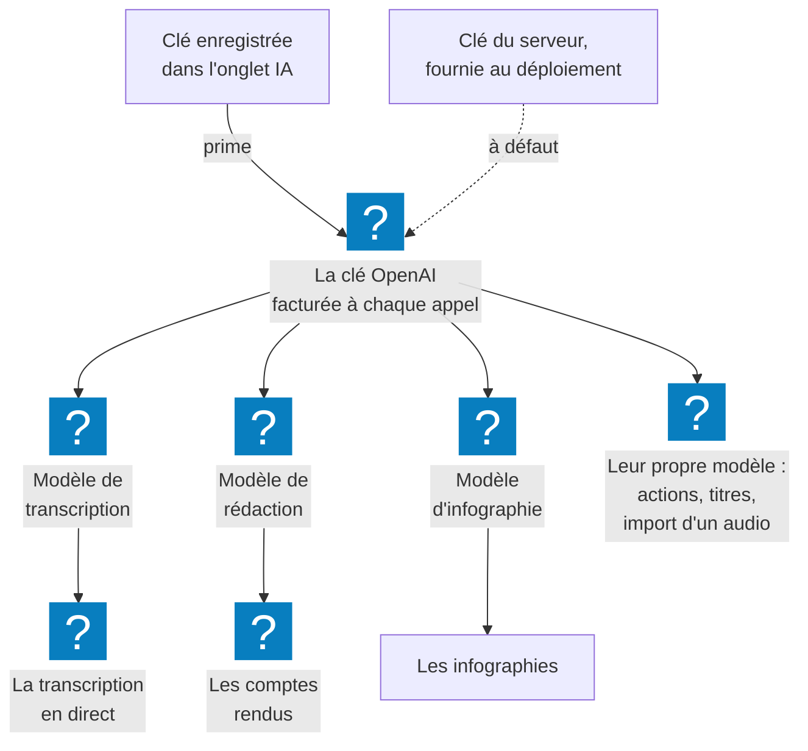

L'onglet **Administration → IA** règle ce qui fait tourner myBrief : la **clé OpenAI** de votre
organisation, le **modèle de rédaction** des comptes rendus, le **modèle de transcription** en direct,
et l'**infographie**.

## À quoi ça sert

À choisir entre qualité et coût, et à garder la main sur ce qui est facturé à votre organisation. Le
modèle de rédaction est le réglage le plus visible de l'instance : c'est lui qui décide de la longueur,
de la clarté et de la structure des comptes rendus.

## Comment ça marche

**La clé OpenAI alimente tout** : la transcription, les résumés, la détection d'actions, les titres et
l'infographie. Chaque appel est facturé sur cette clé, par OpenAI. Sans clé, rien n'est transcrit ni
généré ; quand son crédit est épuisé, les utilisateurs voient « Crédit d'IA épuisé » et vous préviennent.

**D'où vient la clé.** Elle peut être fournie par la configuration du serveur, au déploiement, ou
enregistrée depuis cet écran. **Une clé enregistrée ici prime** sur celle du serveur, aussitôt, sans
redémarrage.

| Réglage | Ce qu'il change | Par défaut |
|---|---|---|
| **Modèle de rédaction du compte rendu** | La qualité, la longueur et le coût des comptes rendus. Ni les titres ni la détection d'actions | **gpt-5.4**, recommandé |
| **Modèle de transcription** | La transcription en direct : sa vitesse, sa finesse, et son coût, affiché pour chaque modèle en € et en euros par heure. L'import d'un fichier audio garde son propre modèle | **gpt-realtime-whisper** |
| **Proposer l'infographie** | La case **Générer une infographie**, pour les comptes dont un groupe donne le droit | Proposée |
| **Modèle qui dessine l'image** | La vitesse, la finesse et le coût de chaque infographie. Ni le format, ni le contenu | **gpt-image-2.5-flare**, recommandé |
| **Style graphique** | Une consigne de charte jointe à chaque infographie | Vide |

**Le modèle de rédaction et celui de transcription se testent avant d'être enregistrés** : un modèle auquel
votre organisation n'a pas accès casserait la fonction pour tous. Le modèle d'infographie n'a pas de
bouton de test — l'essayer reviendrait à produire une image, donc à la facturer. Vérifiez-le en
régénérant une infographie sur une réunion que vous connaissez.

## Configurer

| Réglage | Où | Effet | Page |
|---|---|---|---|
| **Clé API OpenAI** | IA | Tout ce que fait l'IA dans myBrief | [Enregistrer la clé OpenAI](enregistrer-la-cle-openai.md) |
| **Modèle utilisé pour les comptes rendus** | IA → Modèle de rédaction du compte rendu | Les comptes rendus suivants | [Choisir le modèle de rédaction](choisir-le-modele-de-redaction.md) |
| **Modèle utilisé en direct** | IA → Modèle de transcription | Les enregistrements suivants | [Choisir le modèle de transcription](choisir-le-modele-de-transcription.md) |
| **Proposer l'infographie**, **Modèle qui dessine l'image**, **Style graphique** | IA → Infographie de compte rendu | L'infographie, son allure et son coût | [Proposer l'infographie](proposer-l-infographie.md) |

## Exemples de configuration

**Le réglage recommandé.** **gpt-5.4** pour les comptes rendus, **gpt-realtime-whisper** en direct,
infographie proposée et dessinée par **gpt-image-2.5-flare**, style graphique aux couleurs de
l'entreprise.

**Un budget serré.** **gpt-5.4-mini** : des comptes rendus plus ramassés, moins nuancés, pour un coût
moindre. En direct, le modèle de transcription qui affiche un seul **€**. Infographie masquée.

**Des comptes rendus stratégiques.** **gpt-5.6-sol**, le plus capable et le plus cher, pour une
direction qui veut des synthèses fines.

## Vérifier que tout fonctionne

1. **Tester la clé**, puis **Tester l'accès au modèle** et **Tester ce modèle** : les trois au vert.
2. Avec un compte de test : une courte réunion, un résumé, une infographie si elle est proposée — c'est
   ce dernier geste qui valide le modèle qui dessine.

## Voir aussi

- [Les résumés, côté utilisateur](../../fonctionnalites/resumes/index.md)
- [La configuration de l'instance](../configuration/index.md) — le vocabulaire joint aux comptes rendus
- [Estimer les dépenses d'IA](../statistiques/estimer-les-depenses-ia.md) — ce que coûte chaque modèle,
  à l'usage réel de l'instance
