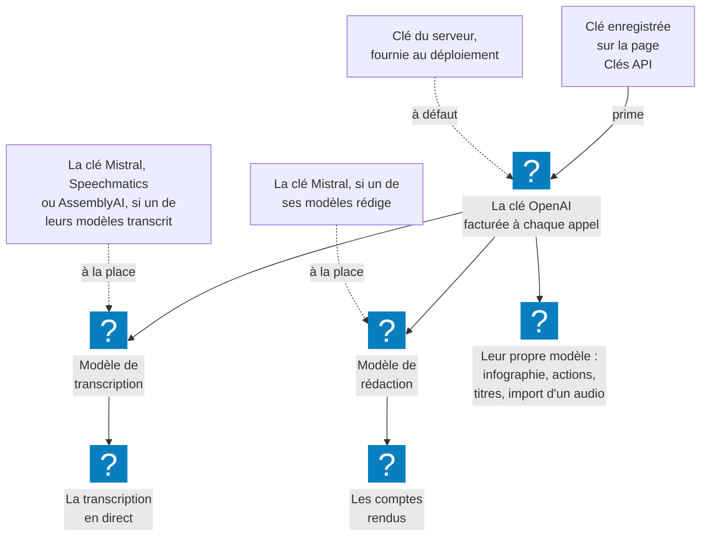

La rubrique **Administration → Modèles IA** règle ce qui fait tourner myBrief, en deux pages : **Clés
API**, pour les **clés** des fournisseurs d'IA de votre organisation ; **Modèles**, pour le **modèle de
rédaction** des comptes rendus, le **modèle de transcription** en direct, et l'**infographie**.

**Clés API** porte la carte **Fournisseurs d'IA** : une pastille par fournisseur — un point vert quand
sa clé est enregistrée, un « + » en pointillés quand elle manque. Un clic sur une pastille ouvre la clé
du fournisseur.

**Modèles** s'ouvre repliée, sur trois tuiles, **Comptes rendus**, **Transcription** et **Infographie**,
qui disent ce qui est en service. Un clic sur une tuile déplie son réglage. Une tuile qui porte
**Modifié** a un changement non enregistré ; **Clé requise**, un modèle dont le fournisseur n'a pas de
clé.

Ce qui demande un geste s'ouvre seul : sur **Clés API**, la clé OpenAI quand elle manque ; sur
**Modèles**, la transcription ou les comptes rendus quand leur modèle attend une clé.

## À quoi ça sert

À choisir entre qualité et coût, et à garder la main sur ce qui est facturé à votre organisation. Le
modèle de rédaction est le réglage le plus visible de l'instance : c'est lui qui décide de la longueur,
de la clarté et de la structure des comptes rendus.

## Comment ça marche

**La clé OpenAI alimente tout** : la transcription, les résumés, la détection d'actions, les titres et
l'infographie. Chaque appel est facturé sur cette clé, par OpenAI. Sans clé, rien n'est transcrit ni
généré ; quand son crédit est épuisé, les utilisateurs voient « Crédit d'IA épuisé » et vous préviennent.

**La transcription peut aussi passer par Mistral, Speechmatics ou AssemblyAI.** La clé d'un
fournisseur débloque ses modèles ; en choisir un lui confie la transcription en direct et l'import des
fichiers audio.

**Les comptes rendus peuvent aussi être rédigés par Mistral.** La même clé Mistral débloque ses modèles
de rédaction. Les titres, la détection d'actions et l'infographie restent chez OpenAI.

**D'où vient la clé.** Elle peut être fournie par la configuration du serveur, au déploiement, ou
enregistrée sur la page **Clés API**. **Une clé enregistrée là prime** sur celle du serveur, aussitôt,
sans redémarrage.

**La clé d'abord, le modèle ensuite.** Chaque page a son bouton **Enregistrer**, et n'enregistre que ce
qu'elle montre : une clé ne se colle pas en même temps qu'on choisit son modèle. Sur **Modèles**, les
modèles d'un fournisseur sans clé enregistrée sont verrouillés ; **Ajouter la clé …** mène à la page
**Clés API**, ouverte sur ce fournisseur. La clé enregistrée, revenez sur **Modèles** : ses modèles se
choisissent. Une clé collée mais pas enregistrée est perdue en changeant de page.

| Réglage | Ce qu'il change | Par défaut |
|---|---|---|
| **Modèle de rédaction du compte rendu** | La qualité, la longueur et le coût des comptes rendus, chez OpenAI ou Mistral : son coût estimé est affiché pour chaque modèle en € et en euros par résumé. Ni les titres ni la détection d'actions | **gpt-5.4**, recommandé |
| **Modèle de transcription** | La transcription en direct, chez OpenAI, Mistral, Speechmatics ou AssemblyAI : sa vitesse, sa finesse, et son coût, affiché pour chaque modèle en € et en euros par heure. L'import d'un fichier audio suit le même fournisseur | **gpt-realtime-whisper** |
| **Proposer l'infographie** | La tuile **Infographie** de la carte de génération, pour les comptes dont un groupe donne le droit | Proposée |

**Le modèle de rédaction et celui de transcription se testent avant d'être enregistrés** : un modèle auquel
votre organisation n'a pas accès casserait la fonction pour tous.

**L'allure des infographies ne se règle pas ici** : elles prennent le logo et les couleurs réglés dans
**Organisation → Marque & apparence** — voir
[Personnaliser l'apparence](../configuration/personnaliser-l-apparence.md).

## Configurer

| Réglage | Où | Effet | Page |
|---|---|---|---|
| **Clé API OpenAI** | Clés API → Fournisseurs d'IA, pastille OpenAI | Tout ce que fait l'IA dans myBrief | [Enregistrer la clé OpenAI](enregistrer-la-cle-openai.md) |
| **Modèle de rédaction du compte rendu** | Modèles → tuile Comptes rendus | Les comptes rendus suivants | [Choisir le modèle de rédaction](choisir-le-modele-de-redaction.md) |
| **Modèle de transcription** | Modèles → tuile Transcription | Les enregistrements suivants | [Choisir le modèle de transcription](choisir-le-modele-de-transcription.md) |
| **Clés Mistral, Speechmatics, AssemblyAI** | Clés API → Fournisseurs d'IA, pastille du fournisseur | Débloquent ses modèles de transcription — et, pour Mistral, de rédaction | [Choisir le modèle de transcription](choisir-le-modele-de-transcription.md), [Choisir le modèle de rédaction](choisir-le-modele-de-redaction.md) |
| **Proposer l'infographie** | Modèles → tuile Infographie | L'infographie, pour les comptes dont un groupe donne le droit | [Proposer l'infographie](proposer-l-infographie.md) |

## Exemples de configuration

**Le réglage recommandé.** **gpt-5.4** pour les comptes rendus, **gpt-realtime-whisper** en direct,
infographie proposée, avec le logo et les couleurs de l'entreprise réglés dans **Marque & apparence**.

**Un budget serré.** Un modèle de rédaction à un ou deux **€** — **GPT-5.4 mini**, **GPT-6 Luna**
ou **Mistral Small 4** : des comptes rendus plus ramassés, moins nuancés, pour un coût moindre. En
direct, le modèle de transcription qui affiche un seul **€**. Infographie masquée.

**Des comptes rendus stratégiques.** **GPT-6 Astra**, le plus capable et le plus cher, ou **GPT-6.1
Sol**, proche de lui pour cinq fois moins cher, pour une direction qui veut des synthèses fines.

**Transcription et comptes rendus chez un fournisseur européen.** La clé Mistral, **Voxtral Realtime** en direct et un modèle
Mistral pour les comptes rendus. Les titres, la détection d'actions et l'infographie restent chez
OpenAI.

## Vérifier que tout fonctionne

1. **Tester la clé**, sur **Clés API**, puis **Tester l'accès au modèle** et **Tester ce modèle**, sur
   **Modèles** : les trois au vert.
2. Avec un compte de test : une courte réunion, un résumé, une infographie si elle est proposée — c'est
   ce dernier geste qui valide le modèle qui dessine.

## Voir aussi

- [Les résumés, côté utilisateur](../../fonctionnalites/resumes/index.md)
- [La configuration de l'instance](../configuration/index.md) — le vocabulaire joint aux comptes rendus
- [Estimer les dépenses d'IA](../statistiques/estimer-les-depenses-ia.md) — ce que coûte chaque modèle,
  à l'usage réel de l'instance
