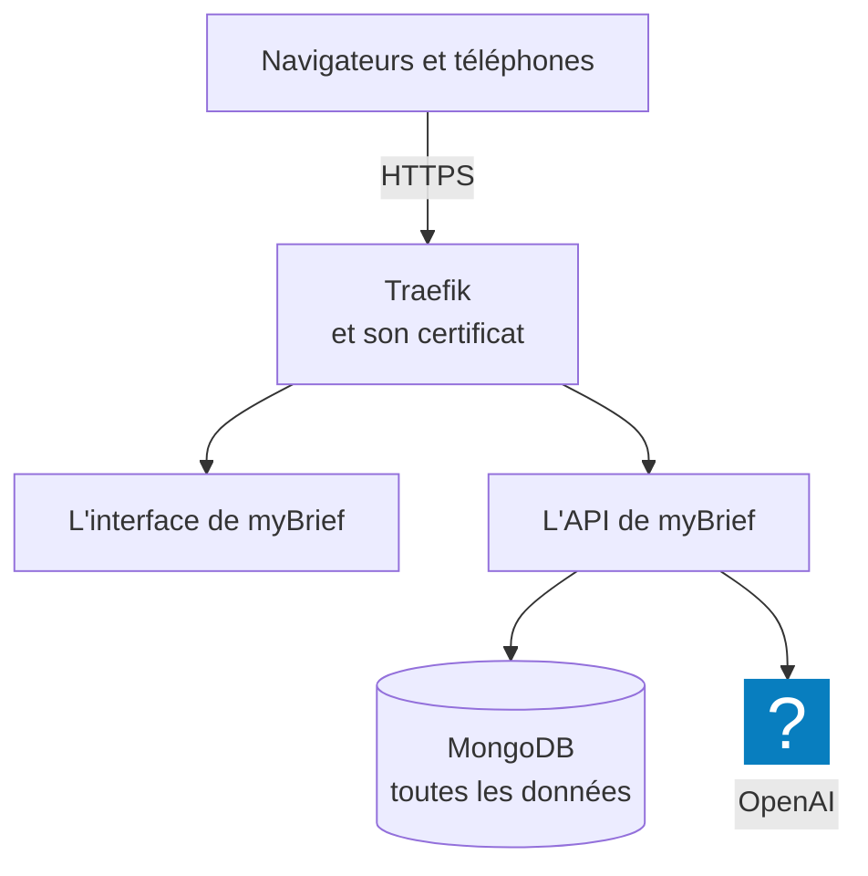

Installer myBrief, c'est poser l'application sur un serveur, avec son adresse et son certificat, puis
faire dans l'administration les quelques réglages sans lesquels personne ne peut s'en servir. Un
installeur fait la première partie en posant quatre questions ; la seconde se fait à l'écran. Ensuite,
le même installeur met myBrief à jour : c'est ce qui apporte les nouveautés aux utilisateurs.

## À quoi ça sert

À mettre en service une instance de myBrief pour une organisation : l'adresse que ses équipes
ouvriront, le premier compte administrateur, la clé d'IA et la façon de se connecter. Ces pages
s'adressent à la personne qui installe — chez MyAlfred ou au service informatique du client —, puis à
l'administrateur qui prend la main.

## Comment ça marche

**L'installeur fait tout ce qui se passe sur le serveur.** Il vérifie que le nom de domaine pointe sur
le serveur, installe Docker s'il manque, écrit la configuration, télécharge myBrief, le démarre, puis
attend que le site réponde en HTTPS. Rien n'est compilé sur le serveur : l'application arrive toute
faite, en images Docker.

**Quatre services tournent ensuite**, chacun dans son conteneur :

- **Traefik** reçoit les connexions et obtient le certificat auprès de Let's Encrypt, qui vérifie le
  domaine avant de le délivrer. Sur un serveur qui a déjà son Traefik, c'est lui qui tient ce rôle :
  l'installeur ne pose alors que les trois autres services.
- **MongoDB** garde toutes les données — comptes, réunions, comptes rendus, templates. C'est la seule
  chose à sauvegarder.
- **OpenAI** reçoit le son et le texte des réunions pour la transcription et les résumés, avec la clé
  de l'organisation.

**Un seul fichier de configuration : `.env`**, écrit par l'installeur dans son dossier. Il contient les
secrets de l'instance, tirés au hasard : le mot de passe de la base, inscrit dans la base à son premier
démarrage — sans lui, elle ne s'ouvre plus —, et la clé qui chiffre en base les comptes Google et
Microsoft reliés par les utilisateurs, ainsi que la clé d'API myBrain. Le fichier reste sur le
serveur, lisible par son seul propriétaire ; gardez-en une copie en lieu sûr, hors du serveur.

**Le dossier de l'installation ne se déplace pas.** Docker nomme les données d'après lui : myBrief
relancé depuis un autre dossier démarre sur une base vide. Rien n'est perdu, mais il faut alors
rapatrier les données de l'ancien volume.

**Le premier compte est un compte d'amorçage.** Il n'est créé que sur une base vide, avec un mot de
passe provisoire tiré au hasard par l'installeur, que myBrief oblige à changer à la première
connexion, avant tout le reste. Tout ce qui suit se règle dans l'administration, sans toucher au
serveur ni redémarrer myBrief.

**Ce que l'installation ne fait pas.** Elle ne planifie aucune sauvegarde. Elle ne renseigne pas de
serveur d'envoi de mails : tant qu'il manque, le lien **Mot de passe oublié ?** est absent de la page
de connexion, et **Envoyer par mail** ne passe que par un compte relié. Les deux se règlent sur le
serveur — voir [Installer myBrief sur le serveur](installer-mybrief-sur-le-serveur.md), « Les réglages
du serveur ».

## Configurer

| Étape | Où | Ce qu'on obtient | Page |
|---|---|---|---|
| Préparer le serveur | Chez l'hébergeur et chez le gestionnaire du nom de domaine | Un serveur, un domaine qui pointe dessus, les ports 80 et 443 ouverts | [Préparer le serveur](preparer-le-serveur.md) |
| Installer myBrief | Sur le serveur : `bash install.sh` | myBrief en ligne, en HTTPS, avec son compte d'amorçage | [Installer myBrief sur le serveur](installer-mybrief-sur-le-serveur.md) |
| Faire les réglages de base | Dans myBrief : **Administration**, dans le menu de compte, puis ses onglets | Votre propre mot de passe, la clé OpenAI, la connexion, les comptes | [Faire les réglages de base](faire-les-reglages-de-base.md) |
| Mettre myBrief à jour | Sur le serveur : `bash install.sh backup`, puis `bash install.sh update` | La dernière version, la base sauvegardée avant | [Mettre à jour myBrief](mettre-a-jour-mybrief.md) |

## Exemples de configuration

**Un serveur neuf pour un client.** Un VPS Ubuntu, le domaine `mybrief.exemple.fr` pointé dessus la
veille. Premier parcours de l'installeur, **VPS vierge** : il installe Docker, obtient le certificat et
démarre myBrief. La clé OpenAI du client n'est pas encore là : la question reste vide, et la clé est
saisie le lendemain dans l'onglet **IA**.

**Un serveur qui héberge déjà d'autres applications derrière Traefik.** Second parcours, **Serveur avec
un Traefik déjà en place** : l'installeur trouve le conteneur de Traefik et propose son réseau ; on lui
donne le point d'entrée HTTPS et le résolveur de certificats de ce Traefik. myBrief ne touche ni aux
ports 80 et 443, ni aux certificats.

**Un serveur que Let's Encrypt ne peut pas joindre**, sur le réseau interne d'une organisation : aucun
des deux parcours ne s'applique tel quel. Cette installation se prépare avec MyAlfred.

## Vérifier que tout fonctionne

- Sur le serveur, dans le dossier de l'installation : `bash install.sh status`. `mongo`, `api` et `web`
  sont `healthy`, `traefik` est `Up`, et la sonde de l'adresse affiche « OK (TLS valide) ».
- Dans un navigateur, l'adresse de myBrief affiche la page de connexion, « Bienvenue sur MyBrief ».
- Les réglages de base faits : une courte réunion avec un compte de test, son résumé, un envoi par
  mail.

## Voir aussi

- [Les utilisateurs](../utilisateurs/index.md), [La connexion](../connexion/index.md) et
  [L'IA](../ia/index.md) : le détail des réglages de base.
- [Installer myBrief sur ses appareils](../../fonctionnalites/installer-mybrief-sur-ses-appareils.md) :
  ce que chaque utilisateur installe ensuite, sur son téléphone et dans Chrome.
