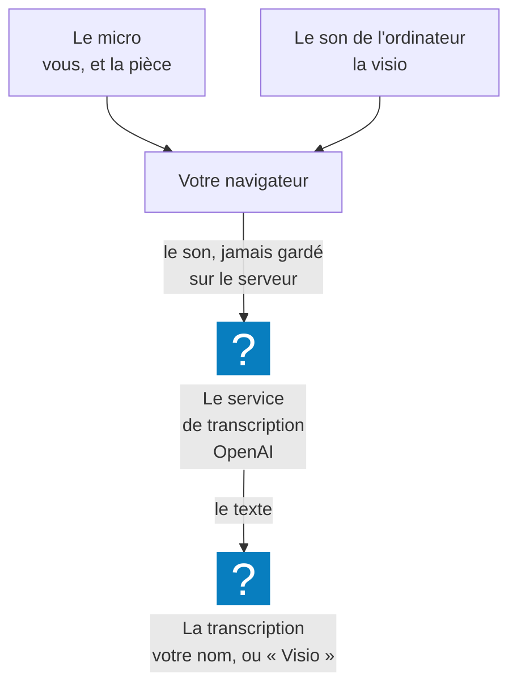

**Enregistrer une réunion**, c'est laisser myBrief l'écouter : il capte le son, l'écrit au fil de la
parole, repère les actions et prépare le compte rendu. Tout commence par **Démarrer**, dans la barre du
bas.

## À quoi ça sert

À suivre la réunion au lieu de la noter. Pendant que vous parlez, la transcription s'écrit à l'écran ;
à la fin, le compte rendu est à un clic.

## Comment ça marche

**Deux sources de son.**

| Source | Ce qu'elle capte | Étiquette dans la transcription |
|---|---|---|
| **Le micro** | Votre voix, et celle des personnes présentes dans la pièce | Votre nom |
| **Le son de l'ordinateur** — en visio | La voix de vos interlocuteurs à distance, le son d'une application | **Visio**, ou le nom que vous leur donnez |

Autour d'une table, le micro suffit. En visio, vos interlocuteurs sortent par vos haut-parleurs ou votre
casque : aucun micro ne les reprend proprement. myBrief vous demande donc de partager votre écran —
non pour l'image, mais pour l'audio qui l'accompagne. Seuls **Chrome et Edge, sur un ordinateur**,
savent le faire. **Firefox et Safari** y arrivent avec un périphérique audio virtuel, installé une
fois sur l'ordinateur : myBrief l'ouvre alors en plus du micro, sans partage d'écran.

**Le déroulé.** Au clic sur **Démarrer**, le navigateur demande l'accès au micro, puis myBrief propose
le partage d'écran. L'écran d'enregistrement s'affiche ensuite : « Enregistrement en cours… », un
chronomètre, et la transcription qui s'écrit ligne après ligne. La réunion apparaît aussitôt dans
l'historique, en italique.

**Pas de séparation automatique des voix.** myBrief distingue deux sources, pas les personnes : tout ce
que capte votre micro vous est attribué, et tous vos interlocuteurs à distance partagent l'étiquette
**Visio**, que vous pouvez renommer — voir [Nommer les participants](../transcription/nommer-les-participants.md).

**La langue.** La transcription se fait dans la langue de l'interface, français ou anglais : une réunion
en anglais s'enregistre avec l'interface en anglais — voir
[Changer la langue](../configuration/changer-la-langue.md).

**Le son ne reste pas chez myBrief.** Il part de votre navigateur vers le service de transcription
(OpenAI) et n'est pas conservé sur le serveur. À la fin, **Télécharger l'audio** en garde une copie
sur votre appareil, tant que vous ne rechargez pas la page.

**Vos minutes de réunion.** Si votre organisation a fixé un quota à votre groupe, un anneau entoure
votre avatar, en bas de la colonne de gauche — en haut à droite sur téléphone —, et la ligne sous votre
nom dit ce qu'il vous reste : « 1 h 15 restantes ». L'anneau se vide au fil du mois,
descend en direct pendant une réunion, et change de couleur avec ce qui reste : vert, ambre sous la
moitié, orange sous un cinquième. Le bloc **Ce mois-ci** du menu de compte détaille le crédit et votre
rythme ; **Voir mes statistiques** ouvre [Mes statistiques](../statistiques/index.md). Quota atteint,
l'anneau passe en rouge, **Démarrer** affiche **Quota atteint**, et un message donne la date du
renouvellement, le 1er du mois suivant. Une réunion commencée n'est jamais coupée. Supprimer une réunion
ne rend pas ses minutes : elles restent décomptées jusqu'au renouvellement. Sans quota, pas d'anneau :
la ligne sous votre nom donne votre adresse.

**Les limites.**

- Une connexion à Internet est nécessaire sur ordinateur ; seule l'application Android enregistre hors
  ligne.
- Au bout de trois heures, myBrief vous demande si la réunion continue ; au bout de huit heures,
  il arrête l'enregistrement — voir [La pause et la fin d'une réunion](../pause-et-fin/index.md).
- Un fichier importé fait 25 Mo au plus.

## Les façons de s'en servir

| Vous voulez… | Page |
|---|---|
| Enregistrer une réunion autour d'une table | [Enregistrer une réunion](enregistrer-une-reunion.md) |
| Entendre aussi vos interlocuteurs de Teams, Meet ou Zoom | [Enregistrer une réunion en visio](enregistrer-une-reunion-en-visio.md) |
| La même chose dans Firefox ou Safari | [Enregistrer une visio dans Firefox ou Safari](enregistrer-une-visio-dans-firefox-ou-safari.md) |
| Lancer une réunion d'un clic, où que vous soyez dans Chrome | [Démarrer une réunion depuis l'extension Chrome](demarrer-depuis-l-extension-chrome.md) |
| Enregistrer avec votre téléphone | [Enregistrer sur son téléphone](enregistrer-sur-son-telephone.md) |
| Transformer un enregistrement existant en compte rendu | [Importer un audio](importer-un-audio.md) |

## Ce que vous pouvez régler

- **Le micro**, appareil par appareil : **Ma configuration → Réglages audio** — voir
  [Choisir son micro](../configuration/choisir-son-micro.md).
- **Le son de l'ordinateur**, dans Firefox et Safari : au même endroit, carte **Son de
  l'ordinateur** — voir
  [Enregistrer une visio dans Firefox ou Safari](enregistrer-une-visio-dans-firefox-ou-safari.md).
- **Le type de réunion**, à chaque démarrage sur ordinateur : **Réunion avec visio** partage l'écran
  pour entendre vos interlocuteurs (dans Firefox et Safari, elle ouvre le son de l'ordinateur),
  **Réunion en présentiel** s'en tient au micro, **Annuler** renonce à démarrer.
- **La langue** de l'interface, qui est celle de la transcription.

Votre administrateur choisit le modèle de transcription utilisé en direct.

## Exemples

**Le point d'équipe en salle.** Ordinateur au milieu de la table, **Démarrer**, **Réunion en
présentiel**. Tout le monde est capté par le micro, sous votre nom ; les actions s'affichent à droite
au fil de la discussion.

**Un rendez-vous client sur Teams.** Vous rejoignez la réunion dans un onglet de Chrome, puis
**Démarrer**, **Réunion avec visio**, **Onglet**, la case de l'audio cochée, **Partager**. Les
répliques du client arrivent avec l'étiquette **Visio**, que vous renommez à son nom.

**Un salon, sans réseau.** Avec l'application Android, vous enregistrez hors ligne ; la transcription
rattrape son retard dès que le téléphone retrouve le réseau.

**Un entretien enregistré sur dictaphone.** Vous importez le fichier depuis **Ma configuration →
Importer un audio**, puis vous générez le compte rendu.

## Voir aussi

- [La pause et la fin d'une réunion](../pause-et-fin/index.md) — suspendre, terminer, reprendre après
  une coupure
- [La transcription](../transcription/index.md) — ce qui s'écrit pendant l'enregistrement
- [La prise de notes](../notes/index.md) et [La détection d'actions](../detection-d-actions/index.md) —
  la colonne de droite, pendant la réunion
