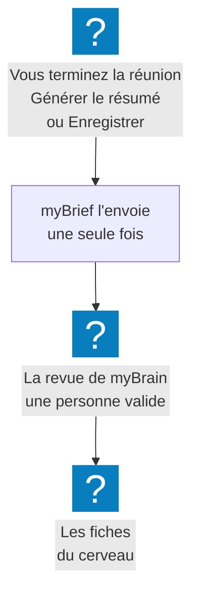

myBrain est le **cerveau partagé** de votre organisation : un wiki d'équipe qui garde ce que l'équipe
sait, fiche par fiche — clients, projets, personnes. Quand votre administrateur l'a relié à myBrief, vos
réunions peuvent l'alimenter.

## À quoi ça sert

Ce qui se dit en réunion — une décision, une échéance, un chiffre, un nouvel interlocuteur — n'arrive
presque jamais jusqu'aux fiches de l'équipe : il faudrait le recopier. Envoyée à myBrain, la réunion
enrichit d'elle-même les bonnes fiches, et chacun retrouve l'information en posant sa question à myBrain.

## Comment ça marche

**Une réunion part quand vous la terminez**, par **Générer le résumé** ou par **Enregistrer**, une fois
son titre trouvé. Elle part **une seule fois** : régénérer le résumé, la renommer ou changer son tag
ensuite ne la renvoient pas. Une réunion arrêtée puis laissée de côté, sans l'un de ces deux gestes, ne
part pas.

**Ce qui part**, en un seul texte :

| | |
|---|---|
| **La réunion** | Son titre, sa date et son heure, sa durée |
| **Vous** | Votre nom et votre adresse, comme auteur |
| **Son rangement** | Son tag |
| **Ce que vous y avez ajouté** | Les notes, les actions — sauf celles que vous avez masquées —, et le compte rendu s'il a été généré |
| **Ce qui a été dit** | La transcription intégrale |

Une très longue réunion part en plusieurs parties, chacune avec sa date et son auteur.

**Rien n'entre dans le cerveau sans être validé.** Chaque réunion arrive en proposition dans la revue de
myBrain, où une personne décide de ce qui rejoint les fiches. Si vous avez un compte myBrain à la même
adresse, c'est à vous que la question est posée ; sinon, au responsable de la fiche concernée, ou aux
curateurs. Voir [Traiter sa revue](https://docs.myalfred.ai/my-brain/fonctionnalites/revue/traiter-sa-revue/),
dans la documentation de myBrain.

**Votre administrateur décide** si l'envoi est désactivé, laissé au choix de chacun, ou imposé à tous.
Laissé à votre choix, il reste **désactivé tant que vous ne l'activez pas**. **Seules partent les
réunions commencées après l'activation** : régénérer le résumé d'une réunion plus ancienne ne l'envoie
pas.

## Les façons de s'en servir

| Vous voulez… | Page |
|---|---|
| Envoyer vos réunions à myBrain, ou arrêter | [Envoyer ses réunions à myBrain](envoyer-ses-reunions-a-mybrain.md) |
| Vérifier qu'une réunion est bien partie, ou la renvoyer après un échec | [Envoyer ses réunions à myBrain](envoyer-ses-reunions-a-mybrain.md#vérifier-ce-qui-est-parti) |

## Ce que vous pouvez régler

Dans **Ma configuration**, groupe **Actions**, **MyBrain** : **Envoyer mes réunions à MyBrain**, quand
votre administrateur vous laisse le choix. Imposé, l'interrupteur est allumé et verrouillé. La section
n'existe pas si myBrain n'est pas relié à votre instance, ou si l'envoi y est désactivé.

## Exemples

**Le suivi d'un client.** Vos réunions avec le client Dupont portent le tag « Client Dupont ». Chaque
réunion terminée arrive dans la revue de myBrain ; une fois validées, les décisions et les échéances
rejoignent la fiche du client.

**Une réunion confidentielle.** L'envoi est à votre choix : coupez-le **avant** de terminer la réunion,
puis rallumez-le. Imposé par votre administrateur, il ne se coupe pas.

**Une journée d'atelier.** Six heures de transcription partent en plusieurs parties, « Envoyée le … —
en 3 parties » : chacune porte la date, l'auteur et le tag.

## Voir aussi

- [La pause et la fin d'une réunion](../pause-et-fin/index.md) — les deux gestes qui envoient la réunion
- [Les résumés](../resumes/index.md) — le compte rendu qui part avec elle
- [Les tags](../tags/index.md) — le rangement qui l'accompagne
