Pendant l'enregistrement, la barre du bas porte deux boutons : **Pause** et **Terminer**. **Pause**
suspend, **Terminer** propose les trois façons de finir — avec un compte rendu, sans, ou en abandonnant
tout.

## À quoi ça sert

À ne capter que ce qui compte : une pause pendant une interruption, un aparté ou le déjeuner d'un
atelier. Et à choisir, à la fin, entre un compte rendu tout de suite ou plus tard.

## Comment ça marche

**La barre du bas change selon l'état.**

| État | Ce qu'elle propose |
|---|---|
| Au repos | **Démarrer** |
| Pendant l'enregistrement | La vague sonore, **Pause** et **Terminer** |
| En pause | « En pause — la réunion n'est pas terminée », **Reprendre** et **Terminer** |
| Après l'arrêt, sans résumé | **Enregistrer** et **Résumer →** |
| Réunion rangée, ou résumée | Plus rien : la barre s'efface, **Résumer** ou **Nouveau résumé** passe à droite des onglets |

**La pause suspend tout** : la capture, la transcription, la détection d'actions et le chronomètre.
Elle n'a pas de limite de durée. La barre du haut affiche « En pause », celle du bas « En pause — la
réunion n'est pas terminée ».

**Trois façons de terminer**, dans « Terminer la réunion ? » — la fenêtre qu'ouvre **Terminer**,
pendant l'enregistrement comme en pause :

| Bouton | Ce qui se passe | Ce qui est gardé |
|---|---|---|
| **Résumer maintenant** | L'enregistrement s'arrête pour de bon, la carte de génération s'ouvre | Tout : transcription, résumé, actions, notes |
| **Enregistrer sans résumé** | L'enregistrement s'arrête, la réunion est titrée et rangée dans l'historique | La transcription, les actions et les notes. Le résumé se génère plus tard |
| **Supprimer la réunion** | La réunion est abandonnée, après confirmation | Rien |

**Annuler** referme la fenêtre sans rien changer : la réunion continue, ou reste en pause. Sur
téléphone, la barre du bas porte en plus **Notes** et **Actions** : voir
[Enregistrer sur son téléphone](../enregistrement/enregistrer-sur-son-telephone.md).

```mermaid
stateDiagram-v2
  accTitle: Les états d'une réunion, et les boutons qui les relient
  accDescr: Démarrer lance l'enregistrement, Pause le suspend, Reprendre le relance. Terminer, pendant l'enregistrement comme en pause, ouvre « Terminer la réunion ? » : Résumer maintenant arrête et rédige le compte rendu, en gardant tout ; Enregistrer sans résumé arrête et range la réunion avec sa transcription, ses notes et ses actions, sans compte rendu ; Supprimer la réunion abandonne tout ; Annuler revient à l'état d'avant.
  state "Enregistrement" as REC
  state "En pause" as PAUSE
  state "Terminer la réunion ?" as FIN
  state "Résumée<br>tout est gardé" as RESUMEE
  state "Rangée<br>tout sauf le compte rendu" as RANGEE
  state "Supprimée<br>rien n'est gardé" as SUPPR
  [*] --> REC : Démarrer
  REC --> PAUSE : Pause
  PAUSE --> REC : Reprendre
  REC --> FIN : Terminer
  PAUSE --> FIN : Terminer
  FIN --> RESUMEE : Résumer maintenant
  FIN --> RANGEE : Enregistrer sans résumé
  FIN --> SUPPR : Supprimer la réunion
```

**Les longues réunions.** Au bout de trois heures d'enregistrement, pauses exclues, myBrief demande
« Toujours en réunion ? » — puis de nouveau à chaque heure. Sans réponse en cinq minutes,
l'enregistrement s'arrête. À huit heures, il s'arrête de lui-même.

**Les coupures.** Fermer ou recharger la page pendant une réunion ne demande aucune confirmation. À la
réouverture, myBrief propose de reprendre : la transcription est conservée, l'audio déjà capté ne
l'est pas.

## Les façons de s'en servir

| Vous voulez… | Page |
|---|---|
| Suspendre l'enregistrement, puis le relancer | [Mettre en pause et reprendre](mettre-en-pause-et-reprendre.md) |
| Arrêter la réunion : avec un compte rendu, sans, ou en l'effaçant | [Terminer une réunion](terminer-une-reunion.md) |
| Retrouver une réunion après une fermeture de page, une longue réunion, une coupure | [Reprendre une réunion interrompue](reprendre-une-reunion-interrompue.md) |

## Ce que vous pouvez régler

Rien à régler : tout se décide dans la barre du bas, au moment voulu. Les seuils de trois et huit heures
sont fixes.

## Exemples

**Une interruption.** Un appel urgent en pleine réunion : **Pause**, puis **Reprendre** dix minutes plus
tard. La transcription reprend à la suite, le chronomètre aussi.

**Un compte rendu tout de suite.** Fin de réunion client : **Terminer**, **Résumer maintenant**, template
**Standard**, **Générer →**.

**Résumer plus tard.** Fin d'un atelier : **Terminer**, **Enregistrer sans résumé**. La réunion est
titrée et rangée, avec ses notes et ses actions ; vous la résumerez demain depuis l'historique.

**Un faux départ.** Vous avez démarré par erreur : **Terminer**, **Supprimer la réunion**, puis
**Supprimer** dans la confirmation. Rien n'est gardé.

## Voir aussi

- [L'enregistrement d'une réunion](../enregistrement/index.md) — le démarrage
- [Les résumés](../resumes/index.md) — ce qui suit **Résumer**
- [L'historique](../historique/index.md) — où va la réunion terminée
