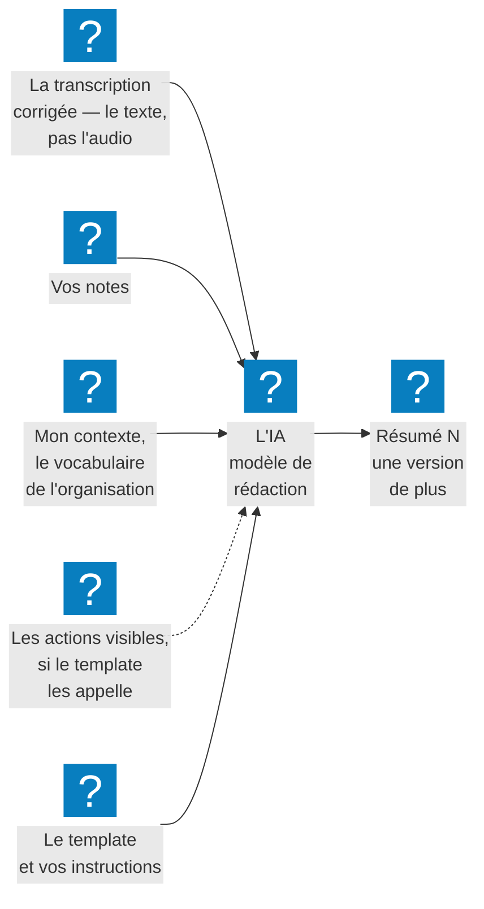

Un **résumé** est le compte rendu que l'IA rédige à partir de la transcription de la réunion, dans la
forme décidée par un [template](../templates/index.md). Il s'affiche dans l'onglet **Résumé** de la
réunion : vous pouvez le retoucher, en générer d'autres versions et le partager.

## À quoi ça sert

À obtenir en quelques instants un compte rendu prêt à diffuser, au lieu de relire une heure de
transcription ou de prendre des notes pendant que les autres parlent.

## Comment ça marche

**Quand le générer.** Cliquez **Terminer**, dans la barre du bas, puis **Résumer maintenant**.
**Résumer maintenant arrête définitivement l'enregistrement.** Vous pouvez aussi terminer par
**Enregistrer sans résumé** et résumer plus tard, depuis l'historique, avec **Nouveau résumé**.

**Ce que vous choisissez**, dans la carte de génération : le template, sa longueur en pages quand il
propose le **Pagimètre** — **Standard** le propose, réglé sur 1 page —, des **Instructions
supplémentaires** facultatives pour ce résumé seulement, et une infographie si votre organisation la
propose. Puis **Générer →**.

**Ce que l'IA reçoit** :

- la **transcription** affichée, avec vos corrections et les noms des participants ;
- vos [notes de réunion](../notes/index.md) ;
- les [actions](../detection-d-actions/index.md) visibles, si le template les appelle ;
- [Mon contexte](../configuration/decrire-son-contexte.md) et le vocabulaire de votre organisation ;
- la durée enregistrée, la date du jour et votre nom.

Le compte rendu est rédigé **dans la langue de l'interface** — voir
[Changer la langue](../configuration/changer-la-langue.md). L'IA ne reçoit pas l'audio : seulement le
texte.

**Chaque génération ajoute une version.** Les onglets **Résumé 1**, **Résumé 2**… se suivent ; rien
n'est écrasé. À la réouverture d'une réunion, c'est la dernière version qui s'affiche.

**Chaque génération retitre la réunion.** myBrief lui donne un titre de cinq mots au plus, qui
remplace le précédent, y compris un titre choisi à la main.

**Le texte se retouche sur place**, et s'enregistre tout seul. Les envois, les dépôts et les
téléchargements partent du texte tel que vous l'avez retouché.

Générer demande une connexion. Un résumé prend de quelques secondes à quelques minutes selon la
longueur de la réunion ; au-delà de cinq minutes, la génération est abandonnée.

## Les façons de s'en servir

| Vous voulez… | Page |
|---|---|
| Obtenir le compte rendu à la fin d'une réunion | [Générer un résumé](generer-un-resume.md) |
| Choisir combien de pages le résumé remplira | [Régler la longueur du résumé (Pagimètre)](regler-la-longueur.md) |
| Résumer une réunion enregistrée sans résumé, ou en tirer un autre format | [Résumer une réunion plus tard](resumer-une-reunion-plus-tard.md) |
| Passer d'une version à l'autre, en supprimer | [Gérer les versions d'un résumé](gerer-les-versions.md) |
| Corriger ou compléter le texte produit | [Éditer un résumé](editer-un-resume.md) |
| Illustrer la réunion d'une image | [Créer une infographie](creer-une-infographie.md) |

Pour envoyer, déposer ou télécharger le compte rendu : [Les actions après réunion](../actions/index.md).

## Ce que vous pouvez régler

- À chaque génération : le template, la longueur avec le Pagimètre, les instructions supplémentaires,
  l'infographie.
- Avant de générer : la transcription, vos notes et vos actions — ce que l'IA lira.
- Une fois pour toutes : vos templates et votre contexte, dans **Ma configuration**.

Votre administrateur choisit le modèle d'IA qui rédige — c'est lui qui fait la qualité des comptes
rendus, et leur longueur quand le template n'a pas de Pagimètre —, le vocabulaire de l'organisation joint à chaque résumé, et si
l'infographie est proposée.

## Exemples

**Un rendez-vous client.** **Terminer**, **Résumer maintenant**, template **Standard**, instruction « mets en avant les
objections du client », **Générer →**. Deux minutes plus tard, le compte rendu part par mail.

**Deux publics, une réunion.** Un premier résumé **Standard** pour l'équipe, puis **Nouveau résumé**
avec **Réunion de décision** pour la direction : deux onglets, deux documents.

**Un nom écorché.** La transcription a écrit « Durend » : vous corrigez la ligne, puis **Nouveau
résumé**. Le nouveau compte rendu écrit le bon nom ; l'ancien reste dans l'onglet précédent.

**Une réunion résumée le lendemain.** Terminée par **Enregistrer** la veille, elle est résumée le matin
depuis l'historique. La pastille **📅 Date** porte alors la date du jour.

## Voir aussi

- [Les templates](../templates/index.md) — la forme du compte rendu
- [La transcription](../transcription/index.md) — la matière première du résumé
- [Les actions après réunion](../actions/index.md) — envoyer, entreposer, télécharger
