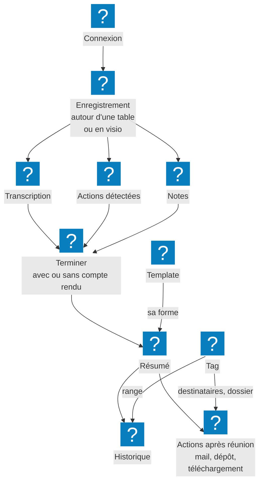

myBrief écoute votre réunion, l'écrit au fil de la parole, repère les actions, puis en tire un compte
rendu structuré. Vous décidez une fois de la forme de ce compte rendu ; il part ensuite par mail, se
range dans votre espace de fichiers ou se télécharge.

Trois gestes sur le chemin principal : **Démarrer**, **Terminer**, **Résumer maintenant**.

## Par où commencer

- [Premiers pas](premiers-pas.md) — se connecter, produire son premier compte rendu, et se repérer sur
  l'écran d'une réunion, zone par zone
- [Installer myBrief sur ses appareils](fonctionnalites/installer-mybrief-sur-ses-appareils.md) — sur
  son téléphone, et dans Chrome
- [Enregistrer une réunion en visio](fonctionnalites/enregistrement/enregistrer-une-reunion-en-visio.md) —
  pour que vos interlocuteurs de Teams, Meet ou Zoom figurent dans la transcription
- [Résoudre un problème](fonctionnalites/resoudre-un-probleme.md) — quand quelque chose ne marche pas

## Comment les sujets s'articulent

Tout commence par la **[connexion](fonctionnalites/connexion/index.md)**, puis
l'**[enregistrement](fonctionnalites/enregistrement/index.md)** d'une réunion, autour d'une table ou en
visio. Pendant qu'elle se déroule, la **[transcription](fonctionnalites/transcription/index.md)** s'écrit,
les **[actions](fonctionnalites/detection-d-actions/index.md)** apparaissent, et vous prenez des
**[notes](fonctionnalites/notes/index.md)**. Une **[pause](fonctionnalites/pause-et-fin/index.md)**
suspend tout ; c'est aussi de là qu'on termine.

À la fin, myBrief rédige le **[résumé](fonctionnalites/resumes/index.md)** dans la forme d'un
**[template](fonctionnalites/templates/index.md)**. Rangée dans un
**[tag](fonctionnalites/tags/index.md)**, la réunion se retrouve dans
l'**[historique](fonctionnalites/historique/index.md)**, et son compte rendu part par les
**[actions après réunion](fonctionnalites/actions/index.md)**. Vos réglages vivent dans
**[Ma configuration](fonctionnalites/configuration/index.md)**.

## Le vocabulaire

| Terme | Ce que c'est |
|---|---|
| **Réunion** | Un enregistrement, sa transcription, ses résumés, ses actions et ses notes |
| **Transcription** | Le texte de ce qui s'est dit, une ligne par prise de parole |
| **Résumé** | Le compte rendu rédigé par l'IA ; chaque génération en ajoute une **version** |
| **Template** | La forme du compte rendu : ce que l'IA doit y mettre, et comment il est construit |
| **Action** | Une tâche repérée pendant la réunion : qui fait quoi, pour quand |
| **Actions après réunion** | Envoyer par mail, Entreposer, Télécharger le compte rendu |
| **Tag** | Un classeur — « Client Dupont » — qui peut porter ses destinataires et son dossier |
| **Visio** | L'étiquette des répliques captées par le partage d'écran, à renommer au nom des participants |
| **Compte relié** | Le compte Google ou Microsoft qui envoie vos mails et dépose vos fichiers |
| **myBrain** | Le cerveau partagé de votre organisation : s'il est relié, vos réunions l'alimentent, après validation — voir [L'envoi des réunions à myBrain](fonctionnalites/mybrain/index.md) |

L'interface existe en **français et en anglais**. Dans myBrief, **Ma configuration → Aide** ouvre
cette documentation dans un nouvel onglet, et le numéro de version, en bas à droite — sur téléphone,
en bas du menu —, ouvre **Quoi de neuf ?**.
