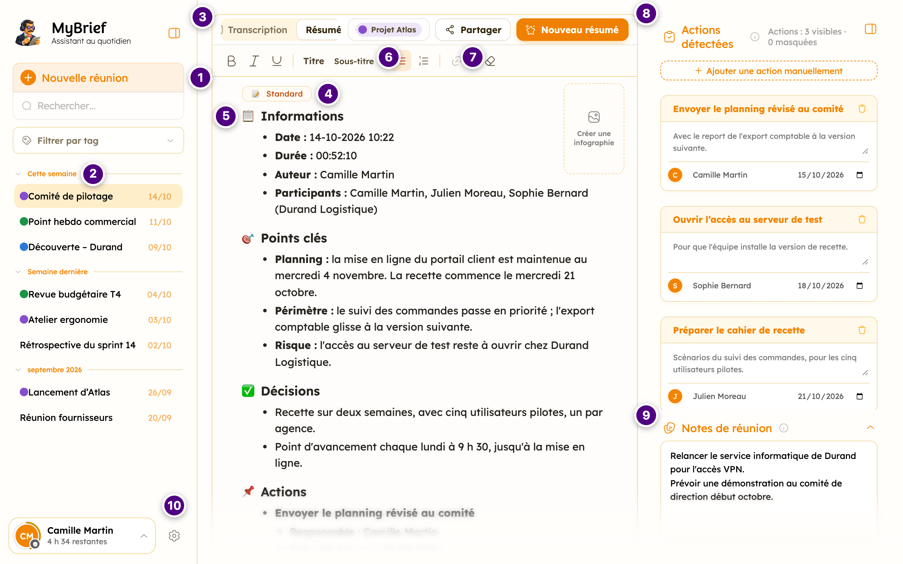

## Avant de commencer

- L'adresse de myBrief de votre organisation, et votre compte.
- Un micro, et l'autorisation de l'utiliser.
- Pour une réunion en visio : **Chrome ou Edge, sur un ordinateur**.

Rien à installer pour la première réunion : myBrief s'ouvre dans un navigateur. Sur un téléphone, ou
dans Chrome, il s'installe ensuite — voir
[Installer myBrief sur ses appareils](fonctionnalites/installer-mybrief-sur-ses-appareils.md).

## Se connecter

Ouvrez l'adresse de myBrief et choisissez **Continuer avec Google**, **Continuer avec Microsoft**, ou
votre adresse et votre mot de passe. Détails : [Se connecter](fonctionnalites/connexion/se-connecter.md).

## Votre première réunion

1. Cliquez **Démarrer**, en bas de l'écran, et autorisez le micro.
2. Sur ordinateur, dans Chrome ou Edge, myBrief demande **Quel type de réunion ?** :
   - autour d'une table, **Réunion en présentiel** ;
   - en visio, **Réunion avec visio**, puis partagez l'onglet de la réunion **en cochant la case de
     l'audio** — voir [Enregistrer une réunion en visio](fonctionnalites/enregistrement/enregistrer-une-reunion-en-visio.md).
3. Parlez : le texte s'écrit au fil de la réunion, et les actions apparaissent à droite.
4. À la fin, cliquez **Terminer**, puis **Résumer maintenant**.
5. Choisissez le template **Standard**, puis **Générer →**.

## Résultat

Le compte rendu s'affiche dans l'onglet **Résumé 1**. La réunion est rangée dans la colonne de gauche,
avec un titre, sa transcription, ses actions et vos notes. **Partager**, à droite des onglets, l'envoie
par mail, la dépose ou la télécharge.

## Se repérer dans myBrief

C'est l'écran que vous retrouvez en ouvrant une réunion depuis l'historique. Chaque numéro renvoie au
sujet qui explique la zone en détail.

| | À l'écran | Le sujet |
|---|---|---|
| **1** | **Nouvelle réunion** : l'écran se vide et l'enregistrement démarre. Sur l'écran d'accueil, c'est **Démarrer**, dans la barre du bas. | [L'enregistrement d'une réunion](fonctionnalites/enregistrement/index.md) |
| **2** | L'**historique** : vos réunions, groupées par semaine puis par mois. Au-dessus, **Rechercher…** et **Filtrer par tag**. Un clic sur une réunion l'ouvre. | [L'historique](fonctionnalites/historique/index.md) |
| **3** | Les onglets de la réunion : **Transcription**, ce qui s'est dit, puis un onglet **Résumé** par version du compte rendu. **Nouveau résumé**, à droite, en rédige une autre. | [La transcription](fonctionnalites/transcription/index.md), [Les résumés](fonctionnalites/resumes/index.md) |
| **4** | Le **template** qui a donné sa forme au compte rendu, ici **Standard**. | [Les templates](fonctionnalites/templates/index.md) |
| **5** | Le **résumé**, que vous corrigez directement ; la barre au-dessus le met en forme. **Créer une infographie**, à droite, en tire une image, si votre administrateur la propose. | [Les résumés](fonctionnalites/resumes/index.md) |
| **6** | Le **tag** de la réunion, ici **Projet Atlas** : il la range, et peut porter ses destinataires et son dossier. Sa couleur marque la réunion dans l'historique. | [Les tags](fonctionnalites/tags/index.md) |
| **7** | **Partager** : **Télécharger le PDF** et, quand ils sont disponibles, **Envoyer par mail** et **Entreposer**. | [Les actions après réunion](fonctionnalites/actions/index.md) |
| **8** | Les **actions détectées** : qui fait quoi, pour quand. Chacune se corrige, et **Ajouter une action manuellement** complète la liste. | [La détection d'actions](fonctionnalites/detection-d-actions/index.md) |
| **9** | Les **notes de réunion** : ce qui n'a pas été dit à voix haute, repris dans le compte rendu. | [La prise de notes](fonctionnalites/notes/index.md) |
| **10** | Votre **nom**, qui ouvre le menu de compte — **Ce mois-ci**, la **Langue**, la sortie —, et la **roue crantée**, qui ouvre **Ma configuration**. Si votre groupe a un quota, l'anneau autour de l'avatar et la ligne sous votre nom disent ce qu'il vous reste ce mois-ci. | [Ma configuration](fonctionnalites/configuration/index.md) |

### Ce que la capture ne montre pas

- **La barre du bas** — **Démarrer**, puis **Pause** et **Terminer** pendant la réunion — est masquée
  quand une réunion terminée est ouverte, comme ici. Voir
  [La pause et la fin d'une réunion](fonctionnalites/pause-et-fin/index.md).
- **Sur un téléphone**, la colonne de gauche se replie derrière le menu, en haut à gauche, à côté du
  logo. Votre **avatar** passe en haut à droite : il ouvre le menu de compte, qui porte aussi
  **Configuration** et, pour un administrateur, **Administration**. Voir
  [Enregistrer sur son téléphone](fonctionnalites/enregistrement/enregistrer-sur-son-telephone.md).
- **Sur une tablette tenue en hauteur, ou dans une fenêtre étroite**, elle se replie en barre
  d'icônes, et s'ouvre par-dessus la page. Voir [L'historique](fonctionnalites/historique/index.md).

## Ensuite

- [Créer son template](fonctionnalites/templates/creer-son-template.md) — le compte rendu qui correspond
  à votre métier
- [Décrire son contexte](fonctionnalites/configuration/decrire-son-contexte.md) — pour des comptes rendus
  qui parlent votre langue
- [Envoyer par mail](fonctionnalites/actions/envoyer-par-mail.md) — régler vos destinataires une fois
- [Les tags](fonctionnalites/tags/index.md) — ranger les réunions par client ou par projet
